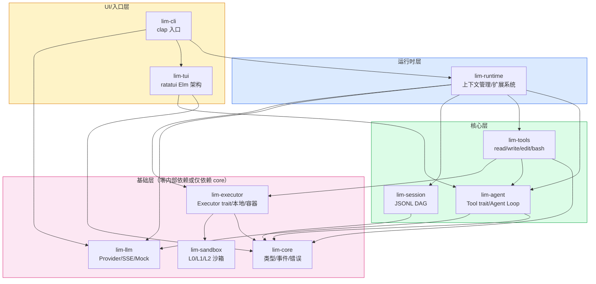
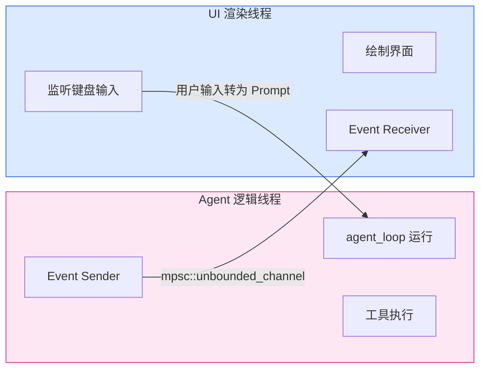
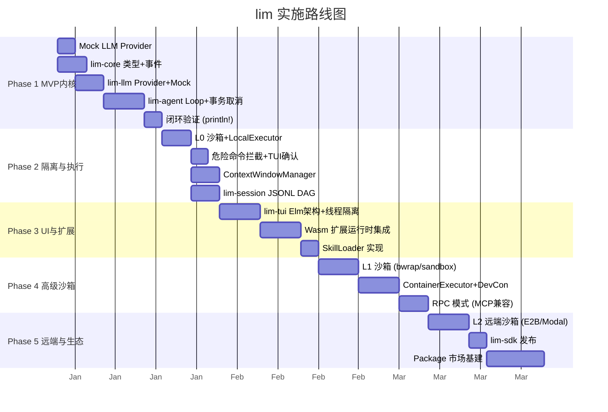

# lim：极简 Rust Agent 工具链架构蓝图

## 一、 项目定位与核心哲学

**lim** 旨在用 Rust 的类型安全和系统级能力，复刻 Pi Agent 的极简哲学，并将其“YOLO（无安全防护）”的短板作为首要解决的问题。

lim 的三大核心支柱：
1. **极简内核**：内核只做“LLM + 工具 + 循环”，拒绝将 Plan Mode、Sub-Agent 等复杂逻辑硬编码进核心。
2. **正交安全**：沙箱（关注隔离边界 L0/L1/L2）与执行器（关注工具依赖）分离，安全作为一等公民，默认启用。
3. **类型安全**：编译期 Schema 生成 + Tagged Enum + 最晚转换，消除运行时不确定性。

---

## 二、 整体架构与模块划分

采用严格的 Workspace 分层，依赖单向流动。通过 `xtask` 在 CI 中强制校验依赖方向，防止环依赖。

### 2.1 模块职责划分

| 层级 | Crate | 职责 | 依赖方向 |
| :--- | :--- | :--- | :--- |
| **基础层** | `lim-core` | 类型系统、事件定义、错误处理、ID 生成 | 零内部依赖 |
| | `lim-llm` | LLM Provider 抽象、SSE 流式解析、Mock Provider | 依赖 `lim-core` |
| | `lim-sandbox` | L0/L1/L2 分层沙箱实现（路径拦截、bwrap、容器） | 零内部依赖 |
| | `lim-executor` | 执行器抽象、本地/容器/远端执行器实现 | 依赖 `lim-core`, `lim-sandbox` |
| **核心层** | `lim-agent` | Tool trait、ToolRegistry、Agent Loop 双层循环、状态机 | 依赖 `lim-core`, `lim-llm` |
| | `lim-tools` | 4 内置工具：read/write/edit/bash | 依赖 `lim-agent`, `lim-executor` |
| | `lim-session` | Append-only JSONL DAG 会话存储 | 依赖 `lim-core` |
| **运行时层**| `lim-runtime`| ContextWindowManager、ExtensionSystem、Wasm 运行时、SkillLoader | 依赖核心层与基础层 |
| **UI/入口层**| `lim-tui` | ratatui 终端 UI，Elm 架构，线程隔离 | 依赖 `lim-agent` |
| | `lim-cli` | 命令行入口，clap 参数解析，模式分发 | 依赖 `lim-runtime`, `lim-tui` |

### 2.2 依赖关系图

---

## 三、 核心运行时机制

### 3.1 消息流与最晚转换

内部所有逻辑（压缩、分支、UI 渲染）基于 `AgentMessage` 运转。该类型包含 LLM 消息（User/Assistant/ToolResult）和非 LLM 消息（Notification/Error/Artifact 等）。
仅在调用 LLM 瞬间，通过 `convert_to_llm()` 函数过滤掉非 LLM 消息，转换为线性的 `LlmMessage` 序列。这保证了 UI 渲染、分支管理和上下文压缩的完整性，同时不污染模型上下文。

### 3.2 Agent Loop：双层循环与事务性取消

采用双层 `while` 循环：外层由 FollowUp 消息驱动，内层由 ToolCall 和 Steering（用户中断）驱动。

**中断与状态一致性保证（事务性执行）：**
当用户发出 Cancel 信号时，系统必须保证不产生脏状态：
*   **文件操作**：`write` 和 `edit` 工具必须先写入临时文件，成功后执行原子 `rename`。收到 Cancel 时丢弃临时文件。
*   **Bash 执行**：Cancel 触发 `SIGTERM`，等待超时后 `SIGKILL`。捕获此时的 stdout/stderr，构造 `ToolResult { is_error: true, output: "Interrupted..." }` 回灌给 LLM，使其知晓任务被中断。

### 3.3 ContextWindowManager (DAG 与 LLM 冲突解决)

会话历史以 Append-only JSONL DAG 格式永久存储，绝不截断。LLM 的线性上下文由 ContextWindowManager 动态构建：
1.  **检测阈值**：当前分支线性消息序列超过 `context_window - reserve` 时触发。
2.  **生成摘要**：调用小模型对超出 `keep_recent` 的旧消息生成结构化摘要。
3.  **注入与裁剪**：将摘要封装为 `LlmMessage::System`，与最近的 `keep_recent` 消息拼接发送给 LLM。DAG 结构保持完整供 UI `/tree` 渲染。

---

## 四、 沙箱与执行器正交体系

这是 lim 区别于其他 Agent 的核心架构决策。**沙箱关注“安全隔离边界”，执行器关注“工具与依赖供给”**。两者通过抽象 trait 解耦，可独立组合升级。

### 4.1 三级沙箱分层

| 级别 | 机制 | 适用场景 | 平台支持 |
| :--- | :--- | :--- | :--- |
| **L0** | **工作目录隔离**：路径白名单、`canonicalize` 防符号链接逃逸、网络白名单、危险命令正则拦截 + TUI 确认。 | 日常开发，零启动开销。 | 全平台 |
| **L1** | **OS 原生/容器沙箱**：封装 `bubblewrap`(Linux) / `sandbox-exec`(macOS) / Docker/Podman 容器。 | 不可信代码，跨项目工具链隔离。 | Linux, macOS |
| **L2** | **虚拟机隔离**：对接 Firecracker microVM 或 E2B/Modal 远端沙箱 API。 | 高度不可信代码，多租户，合规场景。 | Linux, 远端 |

### 4.2 Executor 抽象与组合

工具层（read/write/bash）只依赖 `Executor` 抽象接口，不感知具体后端。接口定义了执行命令、读写文件、声明隔离级别等行为。

**具体实现：**
*   `LocalExecutor`: 直接调用本地进程，内置 L0 沙箱拦截逻辑。
*   `ContainerExecutor`: 通过 Docker API 在 DevContainer 中执行，工作区挂载。
*   `RemoteExecutor`: 通过 HTTP API 调用 E2B/Modal 等远端沙箱。

**组合策略配置：**
用户通过配置文件声明隔离意图，系统自动匹配最优组合：
*   `L0 + Local`：日常开发，零开销。
*   `L1 + Container`：项目隔离，DevContainer 提供工具链 + 容器边界。
*   `L2 + Remote`：完全不可信代码，远端 microVM 执行。

---

## 五、 扩展机制（Wasm 优先策略）

规避 Rust ABI 不稳定问题，采用分层扩展策略：

1.  **一等公民：Wasm 模块**
    *   使用 `wasmtime` 运行 Wasm 扩展，提供稳定的 ABI 和完美沙箱。
    *   扩展通过定义好的 Host Functions 与核心交互（仅传递 JSON 字符串，不传递 Rust 结构体指针）。
2.  **进程级扩展：JSON-RPC**
    *   支持外部进程通过 stdin/stdout 通信，兼容 MCP (Model Context Protocol) 规范，为 Python/Node 生态提供接入点。
3.  **Skills（渐进式披露）**
    *   YAML frontmatter + Markdown 格式。只有 description 常驻上下文（< 1000 token），正文按 trigger 关键词按需加载，避免上下文窗口浪费。

---

## 六、 终端 UI (TUI) 线程隔离架构

遵循 ratatui 最佳实践，采用物理线程隔离的 Elm 架构，坚决避免 UI 卡顿。

**架构铁律：**
*   Agent 线程处理 LLM 调用和工具执行，通过无界通道发送 `AgentEvent`。
*   UI 线程仅负责绘制界面和处理用户输入，接收事件更新状态。
*   UI 线程的 `draw` 调用必须极快，任何阻塞操作（如文件读取、网络请求）必须在 Agent 线程完成。

---

## 七、 配置体系

采用分层配置流，优先级从低到高依次覆盖：

1.  **默认值**：代码内置约定。
2.  **全局配置**：`~/.lim/settings.toml`。
3.  **项目配置**：`./.lim/settings.toml`。
4.  **环境变量**：`LIM_MODEL`, `LIM_API_KEY` 等。
5.  **CLI 参数**：`--model`, `--sandbox-level` 等。

核心配置项包括：模型选择、沙箱级别（auto/l0/l1/l2）、执行器后端、上下文窗口大小、保留 Token 数、并发工具数等。

---

## 八、 分阶段实施路线图

### 关键里程碑验收标准
*   **Phase 1**：使用 Mock Provider 跑通“消息→LLM→tool_call→bash→中断→回灌”闭环，验证事务性取消逻辑。
*   **Phase 2**：L0 沙箱生效（`rm -rf /` 被拦截），长会话触发 ContextWindowManager 摘要且 DAG 历史不丢失。
*   **Phase 3**：TUI 流式渲染无卡顿，能加载一个 Wasm 扩展拦截特定工具调用。
*   **Phase 4**：在 Linux/macOS 上成功通过 `bwrap`/`sandbox-exec` 运行 bash 工具。
*   **Phase 5**：通过 `RemoteExecutor` 在 E2B 沙箱中执行不可信 Python 代码。

---

## 九、 技术栈选型

| 领域 | Crate 选型 | 理由 |
| :--- | :--- | :--- |
| 异步运行时 | `tokio` + `tokio-util` (`CancellationToken`) | 事实标准，取消安全。 |
| LLM 交互 | `reqwest` + `eventsource-stream` + `async-stream` | 流式 SSE 解析，`try_stream!` 编写生成器风格循环。 |
| 序列化/Schema | `serde` + `schemars` | 编译期生成 JSON Schema，用于工具参数校验。 |
| 沙箱-本地 | `bubblewrap`(外部调用) / `nix` | Linux 封装 bwrap，跨平台路径拦截。 |
| 沙箱-容器 | `bollard` | Docker/Podman API 交互。 |
| 扩展运行时 | `wasmtime` | 稳定、高性能的 Wasm 运行时。 |
| 终端 UI | `ratatui` + `crossterm` | 差分渲染，社区活跃。 |
| 错误处理 | `thiserror` (lib) + `anyhow` (bin) | 分层错误传播。 |
| 配置管理 | `config-rs` | 分层配置（默认值/文件/环境变量/CLI）。 |
| Token 计数 | `tiktoken-rs` | 支持 cl100k/o200k/llama3 多编码。 |
| ID 生成 | `ulid` | 可排序，适合会话 DAG。 |

---

## 十、 工程规范

1.  **依赖方向校验**：通过 `xtask` 扫描各 Crate 的 `Cargo.toml`，确保基础层不依赖核心层，核心层不依赖应用层。
2.  **错误处理分层**：库 Crate 使用 `thiserror` 定义可匹配的错误枚举；二进制 Crate 使用 `anyhow` 简化错误传播。
3.  **安全披露**：提供 `SECURITY.md`，沙箱绕过漏洞视为最高优先级处理。
